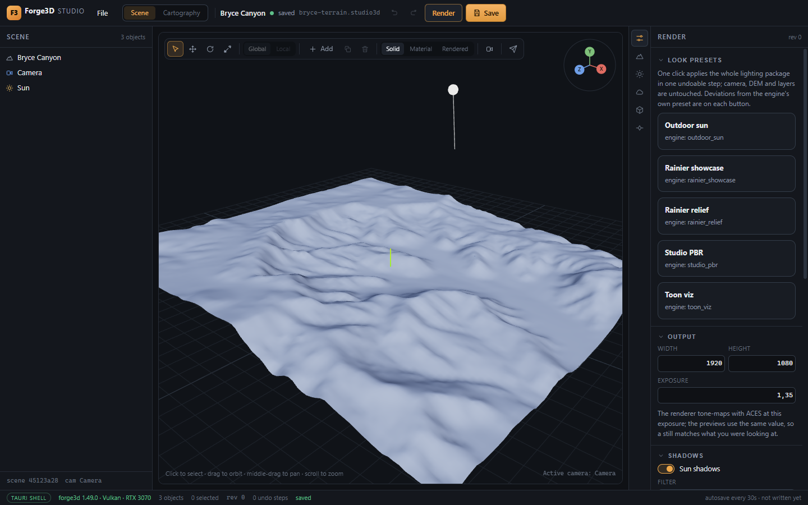
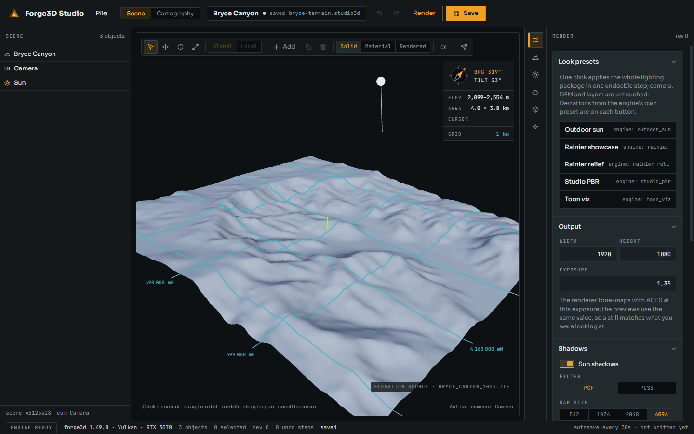

# Field Instrument screenshots

Both screenshots show the saved Bryce Canyon sample in Solid view at 1440 × 900 with the same project camera, GeoTIFF, and local Forge3D 1.49.0 validation engine. Studio ran in the Windows Tauri WebView2. The live viewport used WebGL 2 via ANGLE and Direct3D 11 on an NVIDIA GeForce RTX 3070.

## Before

Studio main at `ee5d8e0`.

## After

The Field Instrument design adds a north arrow, bearing and tilt, an elevation and footprint readout, and a labelled one-kilometre grid.

[Field Instrument design spec](field-instrument-design-system.md)
